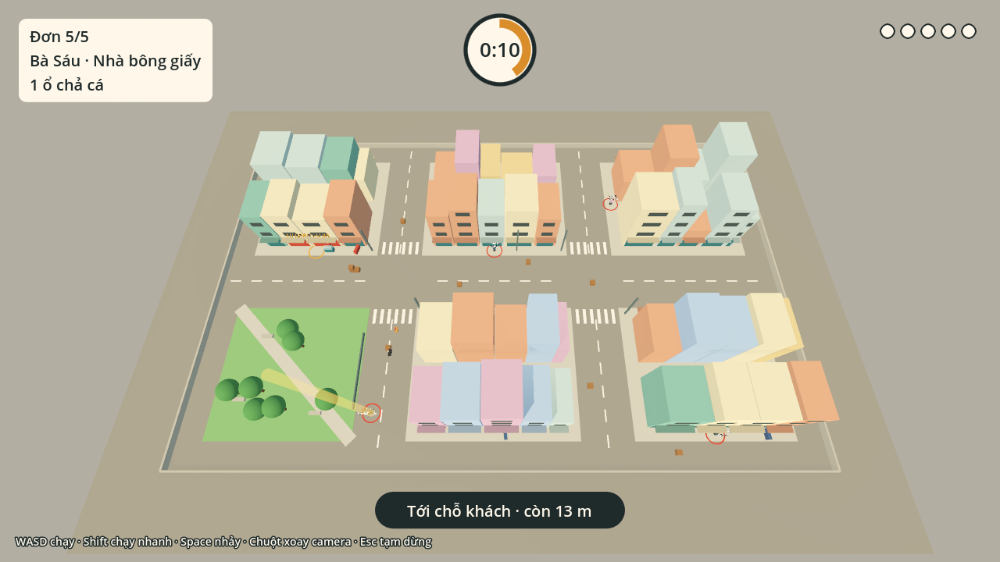
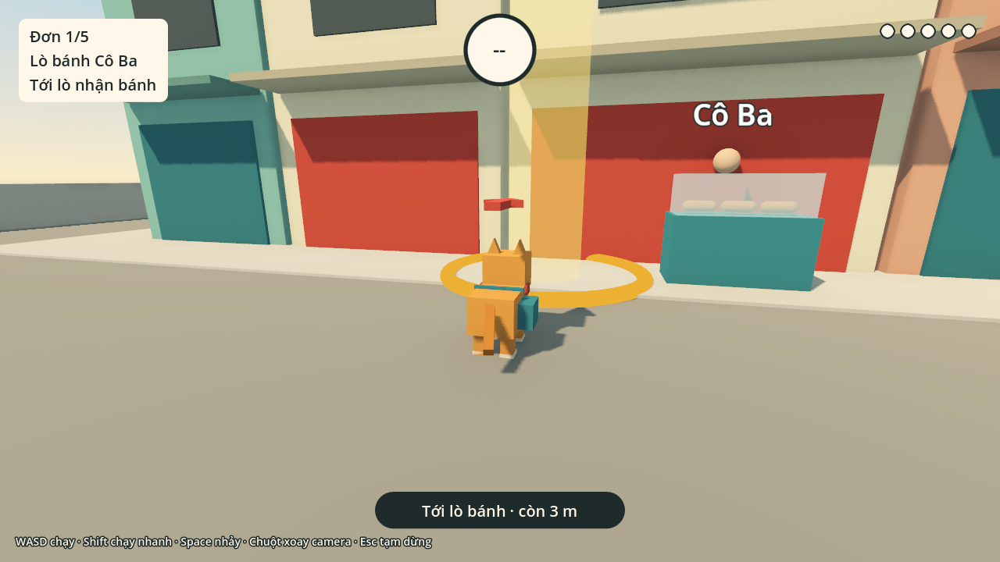
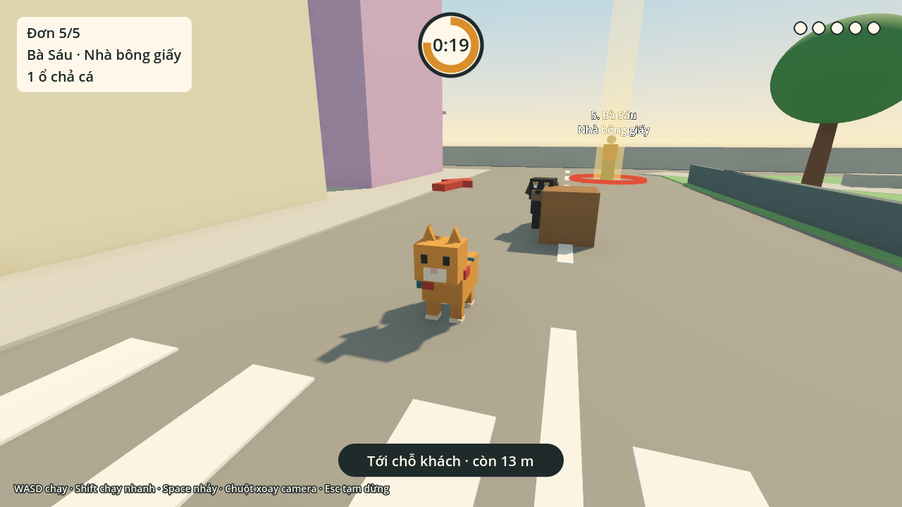
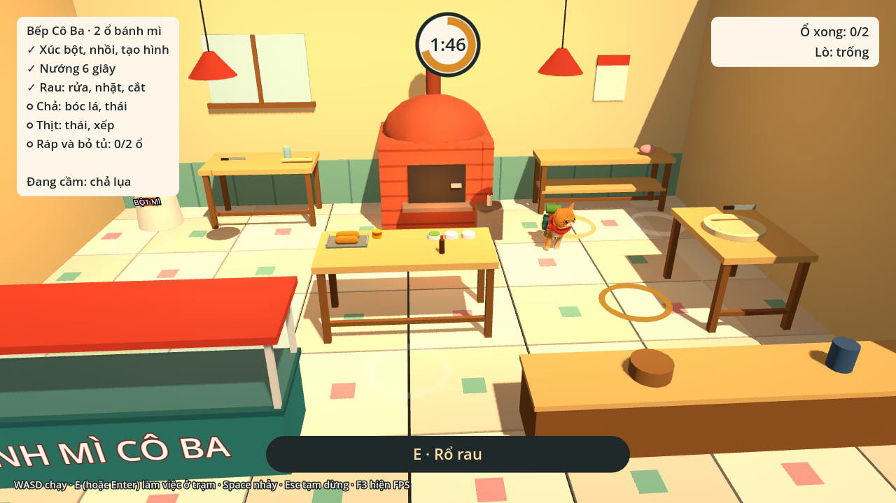

# Mèo Giao Bánh Mì

Game 3D góc nhìn thứ ba làm bằng **Godot 4** (ráp game) và **Blender** (model, rig, animation). Mèo cam Bơ phụ Cô Ba làm bánh mì trong bếp, rồi chạy nhảy khắp khu phố để giao kịp giờ cho 5 khách.

Đây là **bản chơi thử**: mèo Bơ đã dùng model kiểu D "Chững chạc" (bản tạm rút gọn từ model phác thảo), còn phố, khách và Chó Mực vẫn là khối hộp tạm. Mục tiêu là thử cảm giác chạy nhảy và vòng giao đơn trước khi làm đồ họa thật.



| Lò bánh Cô Ba | Đơn 5: Chó Mực canh hẻm |
|---|---|
|  |  |

## Chơi ngay trên trình duyệt

**https://sangdaden.github.io/meo-giao-banh-mi/**

Mở bằng Chrome, Edge hoặc Firefox trên máy tính. Lần đầu tải khoảng 35 MB. Bấm vào khung game để camera bắt chuột; Esc trả chuột lại.

Bản web tự cập nhật mỗi lần nhánh `main` thay đổi (GitHub Actions trong `.github/workflows/pages.yml` xuất bản web rồi đăng lên GitHub Pages). Bản web dùng renderer Compatibility (WebGL 2) nên ánh sáng hơi khác bản chạy trong Godot.

Khi có bản mới, trang đang mở tự biết (mỗi phút hỏi file `version.json` một lần, và mỗi khi quay lại tab). Trang tải sẵn file mới rồi hiện thông báo "Có bản mới!" và tự tải lại sau 10 giây; bấm **Để sau** nếu đang chơi dở. Mã nằm ở `web/update-check.js`; GitHub Actions ghi mã commit vào file này và vào `version.json` mỗi lần đăng.

## Tải bản Windows và macOS

Hai link dưới đây luôn trỏ tới bản mới nhất của nhánh `main`, gửi cho bạn bè chơi thử được ngay.

| Máy | Link tải | Cỡ |
|---|---|---|
| Windows 10/11 (64-bit) | **https://github.com/sangdaden/meo-giao-banh-mi/releases/download/ban-moi-nhat/MeoGiaoBanhMi-windows.zip** | ~30 MB |
| macOS 10.12 trở lên (Intel và Apple M1/M2/M3/M4) | **https://github.com/sangdaden/meo-giao-banh-mi/releases/download/ban-moi-nhat/MeoGiaoBanhMi-macos.zip** | ~55 MB |

### Windows

1. Tải file zip, **giải nén** ra một thư mục.
2. Bấm đúp **MeoGiaoBanhMi.exe**.
3. Nếu Windows hiện "Windows protected your PC", bấm **More info** rồi **Run anyway**. Game chưa ký số nên Windows cảnh báo vậy.

Cần card đồ họa hỗ trợ Vulkan (hầu hết máy từ 2016 trở lại đây).

### macOS

1. Tải file zip. Safari thường tự giải nén; nếu chưa thì bấm đúp file zip. Kéo **Mèo Giao Bánh Mì.app** vào thư mục **Applications** (hoặc để đâu cũng được).
2. Lần đầu mở, macOS sẽ chặn vì app chưa được Apple công chứng (notarize):
   - **macOS 15 Sequoia trở lên**: bấm đúp app, gặp thông báo chặn thì bấm **Done**. Mở **System Settings → Privacy & Security**, kéo xuống mục Security, bấm **Open Anyway** cạnh dòng "Mèo Giao Bánh Mì was blocked", nhập mật khẩu máy, rồi bấm **Open Anyway** lần nữa.
   - **macOS 14 trở xuống**: **chuột phải** (hoặc giữ Control rồi bấm) vào app, chọn **Open**, rồi bấm **Open** trong hộp thoại.
3. Từ lần sau bấm đúp là mở bình thường.

Nếu macOS báo app "is damaged and can't be opened", mở **Terminal** và chạy dòng dưới (sửa đường dẫn nếu để app chỗ khác), rồi mở lại:

```
xattr -dr com.apple.quarantine "/Applications/Mèo Giao Bánh Mì.app"
```

Bản Mac là bản universal (một app chạy được cả chip Intel lẫn chip Apple), chỉ ký ad-hoc. Muốn bỏ hẳn bước "Open Anyway" thì cần tài khoản Apple Developer (99 USD/năm) để ký và công chứng.

### Cách các bản này được làm ra

`.github/workflows/desktop.yml`:

- Mỗi lần nhánh `main` thay đổi, GitHub Actions xuất bằng Godot 4.3:
  - **Windows**: xuất `.exe`, gắn icon `icon.ico` (qua rcedit chạy bằng wine), rồi cho chính `.exe` tự chơi hết 5 đơn bằng `--autotest` để chắc nó chạy được.
  - **macOS**: cho game tự chơi 5 đơn trên Linux, rồi xuất `.app` universal và ký ad-hoc.
  - Hai file zip được thay vào bản phát hành **Bản mới nhất** (tag `ban-moi-nhat`).
- Muốn có một bản đánh số riêng: tạo tag `v` + số, ví dụ `git tag v0.1.0 && git push origin v0.1.0`. Actions tạo bản phát hành `v0.1.0` có cả hai file, và số này được ghi vào thông tin của `.exe` và `.app`.
- Mỗi pull request cũng được xuất và chạy thử; file zip nằm ở mục **Artifacts** của lượt chạy.

Các bản đã đánh số nằm ở trang [Releases](https://github.com/sangdaden/meo-giao-banh-mi/releases).

Trong `export_presets.cfg` còn có sẵn preset **Android** (arm64, chưa ký) cho tuần làm bản điện thoại. Muốn xuất Android cần cài Android SDK. Project đã bật sẵn `rendering/textures/vram_compression/import_etc2_astc` (bản Mac chip Apple và Android đều cần).

## Mở và chơi trong Godot 4

1. Tải **Godot 4.3** trở lên (bản Standard, không cần bản .NET) ở [godotengine.org/download](https://godotengine.org/download). Giải nén là chạy được, không cần cài.
2. Tải code về máy: bấm nút xanh **Code → Download ZIP** trên GitHub rồi giải nén, hoặc `git clone` repo này.
3. Mở Godot, ở Project Manager bấm **Import**, chọn file `project.godot` trong thư mục vừa giải nén, rồi bấm **Import & Edit**.
4. Lần đầu mở, Godot mất vài giây để nhập project. Xong thì bấm **F5** (hoặc nút ▶ góc trên bên phải) để chơi.

## Màn bếp

Vào game là tới bếp Cô Ba trước (`scenes/kitchen.tscn`). Camera đứng cố định ngoài tủ kính nhìn vào. Bơ phải làm **2 ổ bánh mì trong 2 phút 30 giây**, mỗi lần chỉ cầm được một món.



| Trạm | Cần cầm | Các bước (mỗi bước bấm E, có cận cảnh chân Bơ) | Ra món |
|---|---|---|---|
| Bao bột | tay không | Xúc bột | bột |
| Bàn nhồi | bột | Đổ nước · Nhồi bột (×4) · Ủ bột · Chia bột · Vê thành ổ (×2) · Khía mặt (×2) | khay bánh sống |
| Lò gạch | khay bánh sống | Mở cửa · Phun hơi nước · Đẩy khay vào · Đóng cửa | (nướng 6 giây) |
| Lò gạch | tay không, bánh đã chín | Mở cửa · Kéo khay ra (để quá 5 giây là cháy) | khay bánh nướng |
| Kệ: rau, chả, thịt | tay không | Lấy rau / chả lụa / thịt nguội | món sống |
| Thớt | rau / chả / thịt | Rau: Rửa · Nhặt lá úa · Cắt (×3). Chả: Bóc lá chuối · Thái (×3). Thịt: Thái (×3) · Xếp ra đĩa | món đã sơ chế |
| Bàn ráp | bánh hoặc nhân | đặt xuống ngay | |
| Bàn ráp | tay không, đủ bánh + 3 nhân | Xẻ bánh · Phết pate · Kẹp chả, thịt · Thêm rau · Rưới nước tương | ổ bánh mì |
| Tủ kính | ổ bánh mì | Gói giấy · Bỏ vào tủ | xong 1 ổ |

Vòng sáng cam dưới đất chỉ trạm nên tới tiếp; đứng trong vòng thì vòng chuyển vàng và hiện "E · tên trạm". Chấm điểm: ★ làm đủ 2 ổ trước giờ, ★ bánh không cháy, ★ còn dư từ 45 giây. Mỗi sao cộng **2 giây** vào đồng hồ của mọi đơn giao (tối đa +6 giây). Xong bếp bấm Enter là sang màn giao bánh.

Đồ bếp hiện là khối tạm (`scripts/kitchen_props.gd`), màu theo 15 thẻ đồ bếp kiểu D; khi có `.glb` low-poly từ Blender thì thay từng hàm trong file đó.

## Cách chơi màn giao bánh

| Phím | Tay cầm | Việc |
|---|---|---|
| W A S D hoặc phím mũi tên | cần trái | chạy |
| Shift (giữ) | RB hoặc X | chạy nhanh |
| Space | A | nhảy (giữ lâu nhảy cao, bấm nhanh nhảy thấp) |
| Chuột | cần phải | xoay camera |
| V | | đổi góc nhìn thứ ba / thứ nhất |
| Esc | Start | tạm dừng, trả chuột |
| E hoặc Enter | B | làm việc ở trạm trong bếp |
| Enter | | bắt đầu, chơi lại |
| F3 | | hiện hoặc ẩn bộ đếm FPS |

Vòng chơi:

1. Chạy tới vòng tròn cam trước **Lò bánh Cô Ba** để nhận bánh. Đồng hồ bắt đầu đếm ngược từ lúc nhận.
2. Theo **mũi tên đỏ** trên đầu mèo và **cột sáng vàng** ở chỗ khách. Thanh dưới màn hình cho biết còn bao nhiêu mét.
3. Bước vào vòng tròn đỏ dưới chân khách là giao xong. Còn nhiều giờ thì được nhiều sao (3 sao nếu còn từ một nửa thời gian).
4. Hết giờ thì đơn tính là trễ, quay về lò nhận đơn tiếp.
5. **Đơn 5** có **Chó Mực** thức dậy canh hẻm cạnh công viên. Lại gần là nó đuổi; bị đớp thì văng ra và mất 3 giây. Nhảy qua đầu nó thì an toàn.
6. Giao xong 5 đơn là hiện bảng tổng kết sao.

| Đơn | Khách | Món | Thời gian |
|---|---|---|---|
| 1 | Chú Tư · Sạp báo | 1 ổ pate | 18 giây |
| 2 | Bé Na · Chung cư | 2 ổ trứng | 24 giây |
| 3 | Chị Mây · Cà phê Mây | 2 ổ thịt nguội | 20 giây |
| 4 | Anh Hùng · Sửa xe | 3 ổ xíu mại | 30 giây |
| 5 | Bà Sáu · Nhà bông giấy | 1 ổ chả cá | 24 giây, có Chó Mực |

## Chỉnh cảm giác tay

Mọi con số chỉnh được đều nằm ở đầu file script, có chú thích tiếng Việt:

- `scripts/player.gd`: tốc độ chạy, tăng tốc, độ cao nhảy, trọng lực, coyote time (vẫn nhảy được ngay sau khi rời mép), jump buffer (bấm nhảy hơi sớm vẫn tính).
- `scripts/camera_rig.gd`: độ nhạy chuột, khoảng cách camera, góc nhìn thứ ba/thứ nhất (phím V; menu cài đặt gán `first_person`, `invert_y`, `mouse_sensitivity`).
- `scripts/dog.gd`: tốc độ đuổi và tầm nhìn của Chó Mực.
- `scripts/main.gd`: danh sách 5 đơn (vị trí, thời gian), phạt khi bị đớp, `time_multiplier` để nới giờ cho mọi đơn.

## Cấu trúc project

```
project.godot          cấu hình project
scenes/kitchen.tscn    màn bếp (scene chạy đầu tiên), gắn script kitchen.gd
scenes/main.tscn       màn giao bánh, gắn script main.gd
scenes/bo_paw.tscn     một chân trước của Bơ (đặt side = -1 trái, 1 phải)
shaders/bo_fur.gdshader  lông chân Bơ: cam, vằn mảnh, tất kem, sợi lông
scripts/
  kitchen.gd           màn bếp: trạm, luật làm bánh, đồng hồ 2:30, cận cảnh từng bước, bot tự chơi
  kitchen_props.gd     đồ bếp dựng tạm bằng khối
  bo_paw.gd            chân trước của Bơ (BoPaw), dùng chung cho cận cảnh bếp và góc nhìn thứ nhất
  kitchen_camera.gd    camera cố định ngoài tủ kính, lướt vào cận cảnh
  kitchen_hud.gd       giao diện bếp (dùng lại khung của hud.gd)
  game_state.gd        điểm bếp chuyền sang màn giao bánh
  main.gd              vòng chơi: nhận bánh, giao đơn, đồng hồ, mũi tên, phím điều khiển
  player.gd            mèo Bơ: chạy, nhảy, animation tạm bằng code
  camera_rig.gd        camera sau lưng mèo (SpringArm3D tránh xuyên tường)
  dog.gd               Chó Mực: ngủ, thức dậy ở đơn 5, đuổi, đớp
  city.gd              dựng khu phố 6 khối theo bản đồ trong sổ phác thảo
  hud.gd               thẻ đơn, đồng hồ, 5 chấm tiến độ, màn bắt đầu, tạm dừng, kết thúc
  timer_ring.gd        đồng hồ vòng tròn
  blocks.gd            hàm tiện ích dựng khối hộp tạm, gộp mesh cho nhẹ
  sound.gd             autoload "Sound": bus Music/SFX/Ambience, phát tiếng, đổi nhạc, lưu âm lượng
  sound_panel.gd       nút loa góc phải dưới và bảng chỉnh âm lượng
  sound_director.gd    gắn tiếng vào màn giao bánh (bước chân, nhận/giao đơn, đồng hồ, Chó Mực)
assets/audio/          nhạc và tiếng động, nguồn và giấy phép ở assets/audio/NGUON.md
tools/sound/synth.py   tự tổng hợp toàn bộ file âm thanh (pip install numpy scipy, cần ffmpeg)
assets/models/bo.glb   mèo Bơ kiểu D: ~6,3k tam giác, 16 xương (bản tạm)
tools/paw_preview.gd   chụp ảnh chân trước Bơ từ 5 góc (godot -s tools/paw_preview.gd -- <thư mục>)
tools/bo_game.py       tạo bo.glb từ model phác thảo bằng Blender (pip install bpy)
web/update-check.js    bản web tự nhắc tải lại khi có bản mới
docs/                  ảnh chụp cho README (Godot bỏ qua thư mục này)
```

Khu phố rộng 96 × 60 m, gốc tọa độ ở giữa ngã tư; trục X là đông, trục Z là nam, đúng với bản đồ 2D trong sổ phác thảo (1 điểm ảnh = 0,1 m). Layer va chạm: 1 thế giới (đất, nhà), 2 mèo, 4 Chó Mực, 8 đồ vật (thùng, xe, cột, ghế, cây, người). Camera chỉ né layer 1 nên không giật khi mèo chạy qua đồ vật nhỏ.

Model Bơ hiện tại tạo bằng `python3 tools/bo_game.py chung2.glb assets/models/bo.glb`: giảm tam giác, dồn màu lông vào màu đỉnh, gắn 16 xương (đầu, 4 chân, 4 đốt đuôi, 2 tai, 2 mắt, khăn). Game tự xoay các xương này bằng code (hàm `_animate` trong player.gd): chân vung, thân nghiêng khi quẹo và chúi khi tăng tốc, đầu gật và ngó quanh, tai cụp khi chạy, mắt chớp, khăn đung đưa; đuôi (dài ~0,30 m, khoảng 0,55 lần đầu + thân như mèo thật) là chuỗi lò xo nên tự đổi dáng khi đứng, đi, chạy, nhảy, quẹo. Model chính thức 22 xương có animation làm trong Blender sẽ thay vào sau.

Bản khối thô dựng mọi thứ bằng code để dễ đọc từ trên xuống. Khi model Blender xong (tuần 2 và 3), mèo, chó và các mảnh phố sẽ thành scene `.tscn` riêng, thay cho các khối hộp.

## Âm thanh

Toàn bộ nhạc và tiếng động do `tools/sound/synth.py` tự tổng hợp, không dùng mẫu của ai nên không vướng giấy phép (CC0, chi tiết ở `assets/audio/NGUON.md`). Có 4 bài nhạc nền lặp (menu, giao bánh, bị Chó Mực đuổi, bếp), 2 nhạc kết, tiếng nền phố và bếp, cùng khoảng 35 hiệu ứng.

- Gọi từ code: `Sound.play("jump")`, `Sound.music("chase")`, `Sound.ambience("street")`, `Sound.loop("sizzle")` / `Sound.stop_loop("sizzle")`. Tên không có file thì bỏ qua.
- Âm lượng: nút loa góc phải dưới (hiện ở màn bắt đầu, tạm dừng, kết thúc), phím **M** tắt/bật tiếng bất cứ lúc nào. Lưu vào `user://am_thanh.cfg`.
- Cân to nhỏ giữa các tiếng: bảng `LEVEL` đầu file `scripts/sound.gd`. Nhịp bước chân, mấy giây cuối kêu tích tắc, tầm sủa của chó: hằng số đầu `scripts/sound_director.gd`.
- Bản web: trình duyệt chặn âm thanh cho tới cú bấm hoặc phím đầu tiên; Godot tự mở lại khi người chơi bấm, nên nhạc menu bắt đầu ngay khi chạm vào trang.
- In tên từng tiếng ra console khi chạy thử: thêm `--sound-log`, ví dụ `godot --path . -- --sound-log`.

## Tự kiểm tra

Lệnh sau cho mèo tự "dịch chuyển" qua cả 5 đơn, ghé Chó Mực để thử bị đớp, rồi in `AUTOTEST OK` nếu mọi thứ chạy đúng:

```
godot --headless --path . -- --autotest
```

Lệnh này bỏ qua màn bếp. Muốn thử màn bếp, cho Bơ tự chơi hết 2 ổ rồi in `AUTOTEST BEP OK`:

```
godot --headless --path . --fixed-fps 60 -- --autotest-bep
```

Thêm `-- --demo-bep` (không có `--headless`) để xem Bơ tự làm bếp, xong tự sang màn giao bánh. Clip trong PR quay bằng lệnh này cộng `--write-movie bep.avi --fixed-fps 30`.

## Xuất bản chạy trên Windows

1. Trong Godot: **Editor → Manage Export Templates → Download and Install** (chỉ làm một lần).
2. **Project → Export**, chọn sẵn preset **Windows Desktop**, bấm **Export Project**. File `.exe` nằm trong thư mục `export/`, gửi cho người khác chạy thử được luôn.

## Bước tiếp theo

- Tuần 2: model chính thức, rig 22 xương và animation của Bơ; Chó Mực kiểu D (theo model sheet đã duyệt).
- Tuần 3: bộ mảnh phố modular.
- Lộ trình đầy đủ ở sổ phác thảo của dự án.

## Giấy phép

MIT, xem file [LICENSE](LICENSE).
